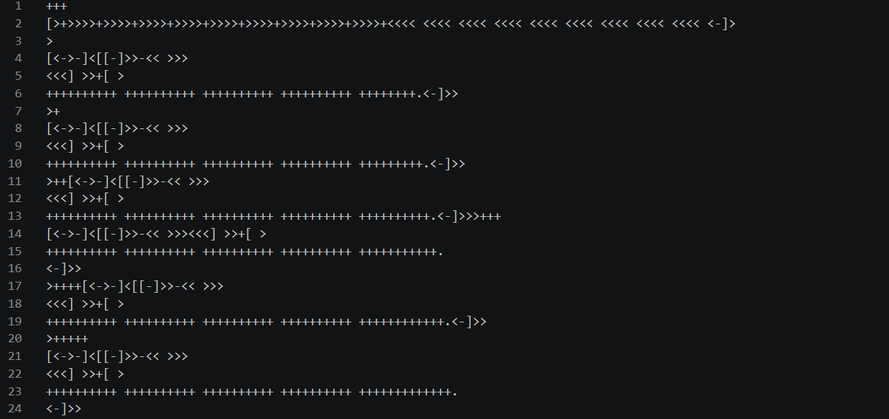

# Brainfuck
brainfuck interpreter and several script brainfuck

[](brainfuck.png)


## what is it
brainfuck interpreter in python and several scripts in brainfuck, to perform simple operations such as "hello world", "if", "fibonacci", "addition", "multiplication"...

## what is brainfuck
Brainfuck is an esoteric programming language, designed to be extremely minimalistic
there is an infinite list of cells and a pointer
a cell contain integer between 0 and 255 (intitialise at 0)  
there is only 6 instructions : 

`+` Add 1 to the current cell. If the cell is at 255, it go back to 0  
`-` Subtract 1 from the current cell. If the cell is at 0, it go back to 255   
`>` Move the pointer one cell to the right  
`<` Move the pointer one cell to the left  
`[` If the current cell is 0, skip to the instruction after the matching `]` otherwise, continue into the loop  
`]` If the current cell is not 0, go back to the matching `[` otherwise, continue past the loop  
`.` Print the current cell's value as an ASCII character  
`,` Read ASCII character from keyboard and store its value in the current cell

To start coding in brainfuck you can get my interpreter and run it with with :  
```sh
python brainfuck.py
```
you will get a terminal where you can type the name of your brainfuck file to run it
##

## why I made this project
Brainfuck is a great puzzle language where everything is hard to do, the best way to see that is a puzzle where you don't watch any brainfuck programm and start with simple programm like "hello world" and "if"
##